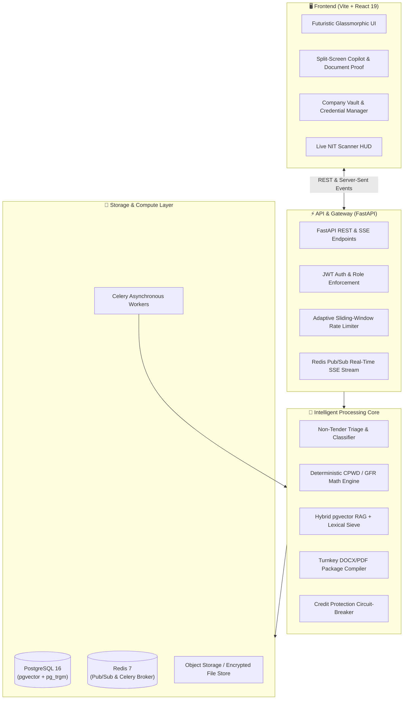

# ⚡ BidKaro — AI Bid Intelligence & Government Tender Copilot

<div align="center">

[](https://fastapi.tiangolo.com)
[](https://react.dev)
[](https://vitejs.dev)
[-336791.svg?style=flat-square&logo=postgresql&logoColor=white)](https://www.postgresql.org)
[](https://redis.io)
[](https://www.docker.com)
[](#license)
[](#-testing--quality-verification)

**Autonomous bid evaluation, statutory CPWD eligibility verification, Company Vault pre-qualification, and turnkey compliance document compiler for Indian public procurement.**

[Quick Start](#-quick-start-local-development) • [Architecture](#-system-architecture) • [Key Capabilities](#-key-capabilities) • [Design System](#-design-system--typography) • [API Reference](#-local-service-urls)

</div>

---

## 🌟 Overview

**BidKaro** is an enterprise AI Copilot engineered specifically for Indian public infrastructure contractors, EPC conglomerates, and public procurement bidders navigating portals such as **GeM, CPPP, State PWDs, NHAI, DFCCIL, MES, and Indian Railways (IREPS)**.

Indian government tenders regularly span **300 to 500+ page NIT packages** containing complex General Conditions of Contract (GCC), Special Conditions (SCC), technical specifications, and strict pre-qualification criteria. A single missed clause, miscalculated CPWD turnover formula, or non-compliant Joint Venture equity distribution can cause immediate technical disqualification.

BidKaro replaces days of manual PDF reading and risky spreadsheet estimations with:
* **Sub-60s NIT Ingestion & Parsing:** Extracts critical criteria, EMD values, tender validity, defect liability terms, and BOQ schedules.
* **Deterministic Statutory Math Engine:** CPWD Works Manual formulas ($2 \times A \times N - B$), $10\%$ compound escalation math for past works, and GFR 170 MSME/Udyam EMD waivers.
* **Interactive Split-Screen Copilot:** Autonomous AI reasoning with page-level PDF proof citations (150 DPI OCR rendered side-by-side).
* **Company Qualification Vault:** Centralized evidence matching against historical balance sheets, CA certificates, and past execution credentials.
* **Turnkey Bid Package Compiler:** Automated generation of submission-ready Cover 1 technical documents (.DOCX/PDF) with guaranteed 0% commercial price leakage.

---

## 🏗️ System Architecture



---

## 🎯 Key Capabilities

### 1. 🔍 Instant NIT Ingestion & Clause Extraction
* Ingests 400-page complex government NIT, RFP, and tender packages in under 60 seconds.
* Categorizes clauses across GCC, SCC, Technical Eligibility, Financial Turnover, EMD, and Defect Liability.
* Identifies joint venture (JV) constraints, lead partner minimum equity thresholds, and subcontracting limits.

### 2. 🧮 Deterministic Statutory Procurement Math
* **CPWD Bid Capacity Formula:** Automatically computes available bidding ceiling:
  $$\text{Available Bid Capacity} = 2 \times A \times N - B$$
  *(where $A = \text{Maximum updated turnover in last 5 years}$, $N = \text{Completion period in years}$, $B = \text{Existing commitments during completion period}$)*
* **Statutory Compound Escalation:** Compound inflation adjustments ($10\%$ p.a.) applied strictly per CPWD Works Manual guidelines to update past project execution values to present rates.
* **GFR Rule 170 / MSME EMD Exemption:** Validates Udyam registration certificates and automatically calculates exact EMD exemption waivers.

### 3. 📄 Split-Screen Document Proof & Citations
* Left-pane autonomous reasoning chat with streaming agent thoughts.
* Right-pane interactive document proof viewer displaying 150 DPI page scans with highlighted clause citations.
* One-click navigation: Clicking any citation chip (`📄 Clause 4.3(a) · Page 42`) immediately focuses and scrolls to the exact paragraph in the source NIT.

### 4. 🏢 Company Knowledge Vault
* Eliminates repetitive document searching across tenders.
* Securely stores and indexes CA-audited balance sheets, 3-year average turnover, solvency certificates, class licenses, and past work completion certificates.
* Automatically surfaces matching credentials and flags pre-qualification gaps before bidding.

### 5. 📦 Turnkey Bid Package Compiler (.DOCX)
* Generates submission-ready Cover 1 technical qualification packages.
* Formats standard CPWD/NHAI proformas (Forms A through G, Pre-Bid Query letters, JV declarations, and litigation affidavits).
* **Zero Commercial Price Leak Audit:** Analyzes generated technical packages through an envelope leak auditor to ensure zero pricing details inadvertently enter Cover 1 technical folders.

### 6. 🛡️ Two-Layer Triage & Credit Protection
* **Smart Non-Tender Classifier:** Detects non-tender documents (e.g. personal Aadhaar cards, PAN cards, invoices) upon upload and safely routes them to the Company Vault without consuming tender processing credits.
* **Disqualification Circuit-Breaker:** Automatically intercepts pipeline progression when an insurmountable statutory blocker is detected, saving the contractor from spending compilation credits on an ineligible tender.

---

## 🎨 Design System & Typography

BidKaro features a next-generation **Futuristic Glassmorphic Design System** engineered for clarity, telemetry visualization, and low eye-strain:

* **Google Gemini Typography Stack:**
  * **Headings & Displays:** `Google Sans` / `Plus Jakarta Sans` with balanced geometric line-heights and humanist curvature.
  * **Editorial Touches:** `Newsreader` (Google's custom curvy roman serif) for highlighted luxury accents (*"High-Stakes"*, *"Bid Intelligence"*).
  * **Financial Metrics & Clause Codes:** `JetBrains Mono` with tabular numerals for high-precision Indian Rupee figures and NIT reference tags.
* **Cosmic Spatial Depth Canvas:** Deep space obsidian void (`#040711`) layered with multi-radius atmospheric nebulas:
  * Top Cyan Laser Beam (`rgba(56, 189, 248, 0.16)`)
  * Solar Flare Glow (`rgba(249, 115, 22, 0.12)`)
  * Cyber Mint Aurora (`rgba(16, 185, 129, 0.10)`)
  * Precision micro-grid dot matrix (`28px` repeat)
* **True Double-Specular Glassmorphic Panels:**
  * Translucent glass surfaces (`62%` alpha) with `backdrop-filter: blur(26px) saturate(200%)`.
  * Top light-catching etched bevel: `inset 0 1px 0 0 rgba(255, 255, 255, 0.25)`.
  * Multi-layer shadows with colored cyber auras.
* **Flagship Holographic Scanner HUD:**
  * Animated sweeping laser beam (`@keyframes laser-sweep`).
  * Live radar beacon with concentric ping waves (`@keyframes radar-ping`).
  * Frosted status capsules with color-coded cyber accent blades.

---

## 🚀 Quick Start (Local Development)

### Prerequisites
* **Node.js** $\ge 18$
* **Python** $\ge 3.11$ (Python 3.12+ recommended)
* **Docker & Docker Compose** (for PostgreSQL + pgvector and Redis)

### Option A: One-Command Startup (Recommended)

Start the entire local development stack (database, cache, backend, Celery worker, and frontend) with a single command:

```bash
./dev.sh
```

or using `npm`:

```bash
npm run dev:all
```

This single command will:
1. Start **PostgreSQL 16 (pgvector)** and **Redis 7** containers.
2. Initialize database schemas & enable `vector` and `pg_trgm` extensions.
3. Automatically seed demo tenant data (NHAI highway tender, MJP water pipeline, company vault).
4. Launch the **FastAPI backend** with hot-reload on `http://localhost:8000`.
5. Launch the **Celery background worker** for background ingestion and document compilation.
6. Launch the **Vite frontend dev server** with HMR on `http://localhost:5173`.
7. Intercept `Ctrl + C` to gracefully stop all background servers and release ports.

---

### Option B: Manual Setup

#### 1. Start Infrastructure Containers
```bash
docker compose up -d postgres redis
```

#### 2. Backend Setup
```bash
cd backend
python -m venv .venv
source .venv/bin/activate  # On Windows: .venv\Scripts\activate
pip install -r requirements.txt

# Run migrations & seed demo data
python scripts/init_db.py
python scripts/seed_demo.py

# Launch FastAPI server
uvicorn app.main:app --host 0.0.0.0 --port 8000 --reload
```

#### 3. Frontend Setup
```bash
# In the repository root
npm install
npm run dev
```

---

## 🛠️ CLI Development Commands

The `./dev.sh` orchestrator provides convenient commands:

```bash
# Check service health and active ports
./dev.sh status
# or: npm run dev:status

# Stop all local development processes and containers
./dev.sh stop
# or: npm run dev:stop

# Re-seed the database with fresh demo data
./dev.sh seed

# Run the 100% containerized stack in Docker Compose
./dev.sh docker
# or: npm run dev:docker
```

---

## 🌐 Local Service URLs

| Service | URL | Description |
|:---|:---|:---|
| **Frontend Web App** | [http://localhost:5173](http://localhost:5173) | Vite React SPA with Split-Screen Copilot |
| **Tender Workspace** | [http://localhost:5173/workspace](http://localhost:5173/workspace) | Live audit, document proof, and bid drafter |
| **Company Vault** | [http://localhost:5173/vault](http://localhost:5173/vault) | Turnover, licenses, and experience credentials |
| **FastAPI Backend** | [http://localhost:8000](http://localhost:8000) | Core REST API & SSE telemetry gateway |
| **Interactive OpenAPI Docs** | [http://localhost:8000/api/docs](http://localhost:8000/api/docs) | Swagger UI for exploring and testing endpoints |
| **ReDoc Documentation** | [http://localhost:8000/api/redoc](http://localhost:8000/api/redoc) | Alternative clean API documentation |
| **PostgreSQL 16 (pgvector)** | `localhost:5432` | DB: `bidkaro` / User: `bidkaro` / Pass: `bidkaro` |
| **Redis 7** | `localhost:6379` | Celery task broker & Redis Pub/Sub SSE hub |

---

## 🔑 Demo Account Credentials

Use these pre-seeded credentials to explore the platform immediately:

* **Email:** `rajesh@apexinfra.in`
* **Password:** `ApexDemo2026!`
* **Company Profile:** Apex Infra Projects Pvt. Ltd. (MSE UDYAM Registered, GFR 170 EMD Exempted, CPWD Class-1A)

---

## 🧪 Testing & Quality Verification

The platform maintains strict automated test coverage across both frontend and backend suites:

### Frontend Unit & Business Logic Suite (19/19 Passing)
Verifies progressive 3-stage delta-credit billing math, smart blocker circuit-breakers, CPWD compound escalation formulas, zero infrastructure string leaks, and non-tender document triage:

```bash
npm test
```

### Backend Integration & API Suite (62/62 Passing)
Verifies RAG vector search, lexical sieve retrieval, deterministic procurement math, document classification, bid package compiler, and API endpoints:

```bash
PYTHONPATH=backend backend/.venv/bin/pytest backend/tests/ -v
```

### Production Build Verification
```bash
npm run build
```

---

## 📂 Repository Structure

```
├── backend/
│   ├── alembic/                # Alembic database migrations
│   ├── app/
│   │   ├── api/                # FastAPI routers (tenders, vault, boq, compiler, admin)
│   │   ├── core/               # App configuration, security, database session, rate limiting
│   │   ├── models/             # SQLAlchemy ORM models (pgvector embeddings, tenants, audits)
│   │   ├── schemas/            # Pydantic validation schemas
│   │   ├── services/           # Procurement math, RAG hybrid, document compiler, LLM router
│   │   ├── workers/            # Celery tasks (asynchronous OCR ingestion, doc generation)
│   │   └── main.py             # FastAPI entrypoint
│   ├── docker/                 # Postgres initialization scripts
│   ├── scripts/                # Database bootstrap & demo seeders
│   ├── tests/                  # Pytest test suite (62 tests)
│   ├── Dockerfile              # Backend container definition
│   └── requirements.txt        # Python dependencies
├── src/
│   ├── components/             # Reusable UI components, GlassCard, modals, and tabs
│   │   ├── common/             # GlassCard, GlassBadge, PageHeader, GeminiGlowBackground
│   │   ├── layout/             # AppShell, TenderWorkspaceHeader
│   │   ├── modals/             # JV Calculator, Envelope Leak Audit, Corrigenda Diff
│   │   └── workspace/          # DocumentProofTab, EligibilityTelemetryTab, BidCompilerTab
│   ├── context/                # React contexts (AuthContext, ThemeContext, BidKaroStore)
│   ├── data/                   # Mock data and initial state
│   ├── pages/                  # Route views (Workspace, Dashboard, CompanyVault, Wallet, etc.)
│   ├── services/               # Frontend API client and event listeners
│   ├── styles/                 # Global styles and design tokens
│   ├── App.jsx                 # Application routing
│   └── index.css               # Futuristic glassmorphism CSS engine & animations
├── tests/                      # Frontend Node.js business logic tests (19 tests)
├── dev.sh                      # Unified dev orchestrator script
├── docker-compose.yml          # Multi-container orchestration (Postgres, Redis, Backend, Celery)
├── Dockerfile.frontend         # Frontend production container definition
├── index.html                  # HTML template with Google Gemini typography loader
├── nginx.conf                  # Production reverse proxy configuration
├── package.json                # Frontend dependencies and npm scripts
└── vite.config.js              # Vite bundler configuration
```

---

## 🔒 Security & Data Protection

* **Commercial Price Leakage Prevention:** Two-tier scan ensuring financial BOQ rates cannot accidentally populate technical Cover 1 submission folders.
* **Zero Technical Leak Policy:** User-facing client code and responses are filtered to ensure underlying database and infrastructure details (e.g. pgvector, BM25, Redis keys) never leak to client browsers.
* **Isolated Multi-Tenant Security:** Tenders, documents, and Company Vault evidence are strictly segregated by tenant ID with role-based access control.

---

## 📄 License

This repository is proprietary software. All rights reserved.

---

<div align="center">
  <sub>Built with ⚡ by the BidKaro Engineering Team for Indian Infrastructure Contractors.</sub>
</div>
