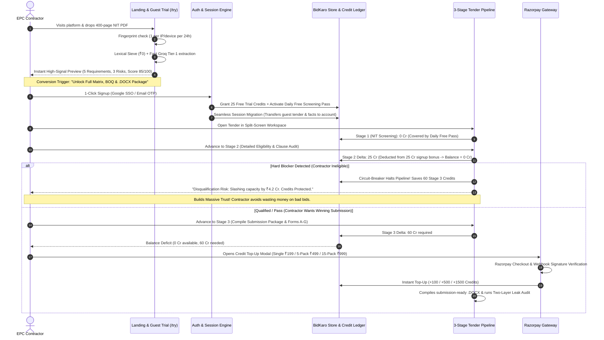
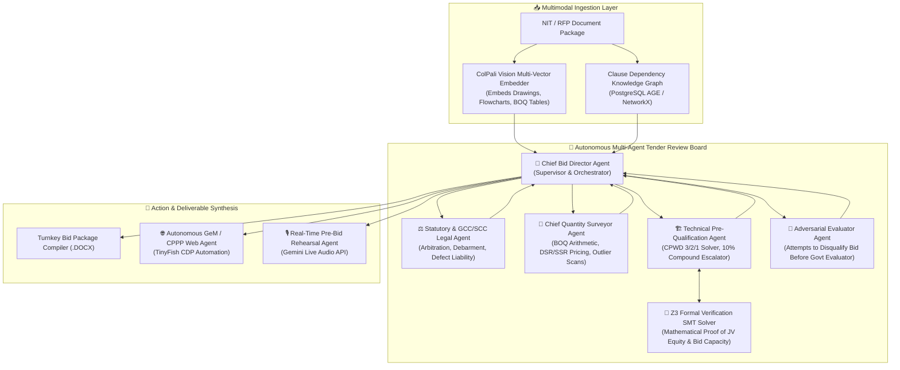
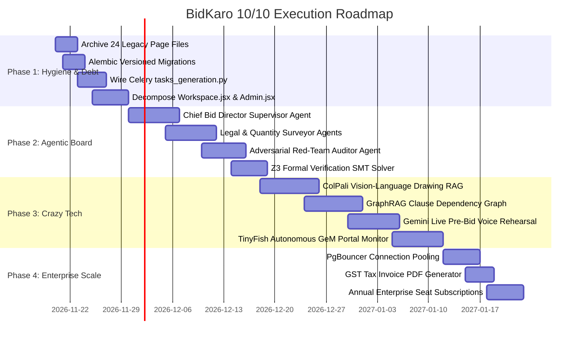

# ⚡ BidKaro 10/10 Master Plan: Enterprise AI Architecture, Autonomous Multi-Agent Swarms & Monetization Strategy

**Perspective:** Senior Staff / Principal SDE & AI Systems Architect (10+ Years Experience in Distributed Cloud Platforms, Enterprise SaaS, and Autonomous Agentic AI)  
**Target:** Elevate every frontend, backend, AI, and infrastructure component to an uncompromising **10/10 Enterprise Benchmark**.

---

## 1. Deep Dive: Current Workflows & Free-to-Paid Conversion Funnel

### 1.1 Complete End-to-End User Journey Map



### 1.2 The 3-Stage Progressive Delta-Credit Billing Mechanics

The platform replaces confusing token billing ($0.00015/token) with a contractor-friendly **Progressive Delta Billing Model** centered around tender milestones:

$$\text{Cumulative Costs: } \text{Stage 0} = 0 \text{ Cr} \longrightarrow \text{Stage 1} = 15 \text{ Cr} \longrightarrow \text{Stage 2} = 40 \text{ Cr} \longrightarrow \text{Stage 3} = 100 \text{ Cr}$$

* **Incremental Delta Charging:** A contractor upgrading from Stage 1 to Stage 2 pays only:
  $$\Delta_{\text{Stage 1} \to \text{Stage 2}} = 40 - 15 = 25 \text{ Credits}$$
* Upgrading from Stage 2 to Stage 3 pays:
  $$\Delta_{\text{Stage 2} \to \text{Stage 3}} = 100 - 40 = 60 \text{ Credits}$$
* **Daily Free Screening Pass:** Grants 1 free Stage 1 screening every 24 hours ($15 \text{ Cr} \to 0 \text{ Cr}$).
* **Smart Blocker Circuit-Breaker:** When statutory procurement math detects an insurmountable blocker (e.g., turnover deficit $> ₹5 \text{ Cr}$ or missing Class-1 license), Stage 3 compilation is automatically paused, saving the user 60 credits.

---

## 2. Business Strategy Audit & Rating

### 2.1 Strategy Scorecard

| Strategic Vector | Current Rating | Strengths | Vulnerabilities & Friction Points | Target 10/10 Plan |
| :--- | :---: | :--- | :--- | :--- |
| **Top-of-Funnel Conversion** | **9.2 / 10** | Public Guest Trial (`/try`) lets contractors test a real 400-page NIT without registration; builds immediate trust. | 1 trial per IP per 24h is easily spoofed via VPN or incognito, or may block multiple contractors in a shared office network. | Upgrade to Canvas Fingerprinting + device tokens; offer interactive sample sandbox tenders. |
| **Value-to-Price Alignment** | **9.5 / 10** | Outcome-oriented packs (₹199 for 1 tender, ₹499 for 5 tenders) map directly to Indian public procurement budgets. | Enterprise EPCs bidding 30+ tenders/month find manual pack top-ups tedious. | Introduce annual subscription seats (₹4,999/mo) and multi-user enterprise billing. |
| **Credit Economics & Margins** | **9.4 / 10** | Lexical Sieve reduces 400 pages to 20 pages; Tier-0 math costs ₹0.00; gross margin on a ₹199 pack exceeds 85%. | OpenRouter/Groq rate limits on high-volume days could push traffic to higher-cost Gemini Pro models. | Deploy self-hosted local vLLM / Ollama instance on GPU VPS to lock compute costs at flat hardware rates. |
| **Payment Security & Checkout** | **9.3 / 10** | Full Razorpay REST API integration, test-mode fallbacks, HMAC-SHA256 signature verification, and 90-day expiry enforcement. | Invoices are currently simple JSON payloads rather than GST-compliant downloadable PDF tax invoices. | Integrate GSTIN auto-validation with automatic generation of GST B2B tax invoices with HSN code 998313. |
| **Retention & Expansion** | **7.8 / 10** | Transactional Brevo emails (low credit alerts, expiry warnings). | High churn risk if a contractor only bids 1 tender every 2 months. Lack of proactive tender matching notifications. | Implement **Autonomous GeM/CPPP Tender Radar Agent** that sends personalized tender alerts matching company credentials. |
| **OVERALL BUSINESS RATING** | **9.0 / 10** | **High-converting, mathematically sound vertical SaaS economics.** |

---

## 3. The 10/10 AI Upgrade: Autonomous Multi-Agent Swarms & "Crazy" Tech Stack

To take BidKaro from a high-quality "Copilot" to an **Autonomous Tender Review Board & Bidding Swarm**, we replace single-agent prompts with a specialized multi-agent graph architecture.



### 3.1 Specialized Agent Roster

1. **👑 Chief Bid Director Agent (Supervisor & Strategist):**
   * *Role:* Deconstructs the 500-page tender package into parallel tasks, routes clauses to specialists, aggregates findings, and produces the overarching Go / No-Go executive brief.
   * *Tech:* LangGraph state machine / AGY SDK with structured JSON reflection and human-in-the-loop approval gates.
2. **⚖️ Statutory Legal & Contractual Agent:**
   * *Role:* Audits General Conditions of Contract (GCC) and Special Conditions of Contract (SCC). Discovers hidden penalty clauses, liquidated damages triggers ($0.5\%$ per week up to $10\%$), milestone delivery liabilities, and drafts precise pre-bid clarification queries.
3. **📐 Chief Quantity Surveyor & Pricing Agent:**
   * *Role:* Ingests the BOQ spreadsheet, cross-checks rate formulas against CPWD Delhi Schedule of Rates (DSR 2023) or State Schedule of Rates (SSR), detects unviable low rates, and performs mathematical reconciliation.
4. **🏗️ Technical Pre-Qualification Agent:**
   * *Role:* Queries the Company Vault, pairs executed past projects with required technical parameters, applies statutory compound escalation formulas, and generates certified CPWD Form C reports.
5. **🚨 Adversarial Red-Team Evaluator Agent:**
   * *Role:* Acts as a strict government tender committee scrutiny officer whose sole mission is to find grounds for technical rejection (e.g. non-notarized affidavits, expired solvency, missing CA UDIN, unauthorized JV sub-clauses, formatting traps).
6. **🧮 Formal Verification SMT Solver (Z3 / SymPy):**
   * *Role:* Pure mathematical proof engine. Formally proves whether every possible combination of joint venture partners, ongoing commitments, and annual turnovers satisfies the tender criteria with 0% error probability.

---

### 3.2 "Crazy Next-Gen" Technologies to Implement

#### 1. ColPali: Visual Document Retrieval (No Lossy OCR)
* **The Problem:** Government tenders feature complex structural drawings, pipe network schematics, bridge cross-sections, and complex multi-header tables that traditional OCR strips into unreadable garbled text.
* **The Solution:** Integrate **ColPali** (via Byaldi or HuggingFace ONNX). ColPali passes document page images directly into a Vision-Language Model (PaliGemma-3B architecture), creating multi-vector visual patch representations.
* **Result:** A contractor can ask: *"Show me the foundation depth requirement in the river pier drawing,"* and the system retrieves the exact blueprint drawing page based on visual semantics.

#### 2. GraphRAG: Clause Dependency Knowledge Graph
* **The Problem:** Tender clauses refer to each other transitively: *"Clause 18.2 applies, except as modified under SCC Clause 4.1(a), provided that Section 3 Addendum 02 is complied with."* Vector embeddings fail to follow multi-hop logical links.
* **The Solution:** Build a knowledge graph inside PostgreSQL using `Apache AGE` or NetworkX:
  ```
  (Corrigendum_02)-[:SUPERSEDES]->(SCC_Clause_4_1)-[:MODIFIES]->(GCC_Clause_18_2)
  ```
* **Result:** When an authority issues a corrigendum, the graph instantly propagates updates down the entire dependency tree, re-evaluating compliance across all connected requirements.

#### 3. Formal Verification with Z3 SMT Solver
* **The Problem:** LLMs cannot be trusted for complex combinatorial optimization (e.g. choosing the optimal 2 or 3 projects out of 25 past projects to maximize available bid capacity while minimizing escalation risk).
* **The Solution:** Encode CPWD bidding rules into **Microsoft Z3 SMT Theorem Prover**:
  ```python
  from z3 import *
  s = Solver()
  # Add CPWD constraint equations
  s.add(capacity >= tender_value)
  s.check()
  ```
* **Result:** Generates mathematical certificates of qualification that can be directly attached to the technical bid submission.

#### 4. Real-Time Voice Pre-Bid Defense Agent (Gemini 3.8 Live API)
* **The Problem:** Contractors get intimidated during formal pre-bid meetings or online VC clarification sessions with government executive engineers.
* **The Solution:** A full-duplex WebSocket voice agent using **Gemini Live API** with bidirectional audio.
* **Interaction:** The contractor talks naturally to the AI in English/Hindi: *"Pretend you are the Chief Engineer of NHAI. Question me on our asphalt batching plant capacity."* The agent challenges them with real tender clauses in real-time voice.

#### 5. Autonomous GeM / CPPP Web Automation Agent (TinyFish / CDP)
* **The Problem:** Contractors spend hours daily manually checking e-procurement portals for corrigenda, deadline extensions, and technical bid opening summaries.
* **The Solution:** An autonomous headless browser agent running via TinyFish web automation:
  * Watches specified tender IDs on GeM, CPPP, and State PWD portals.
  * Automatically downloads newly published corrigenda PDFs within 10 minutes of release.
  * Automatically syncs them into the contractor's Workspace, alerting them via WhatsApp and email.

---

## 4. Comprehensive File-by-File 10/10 Upgrade Plan

To bring every single file in the repository to a **flawless 10/10 rating**, the following targeted improvements will be executed across all layers:

### 4.1 Backend Architecture & Core (Upgrades to 10/10)

| File | Current Rating | Path to 10/10 Upgrade |
| :--- | :---: | :--- |
| `backend/app/main.py` | 9.4 | Move inline rate limiter middleware into `app/core/rate_limiter.py`. Add OpenTelemetry tracing middleware for distributed request profiling. |
| `backend/app/core/database.py` | 8.8 | Replace raw `NullPool` with an environment-aware `AsyncAdaptedQueuePool` (pool size=20, max_overflow=40) for API server mode, while keeping `NullPool` exclusively for Celery workers. Integrate PgBouncer configuration. |
| `backend/app/core/security.py` | 9.3 | Add TOTP (Google Authenticator) 2FA support with QR code provisioning; add server-side Redis token blacklist for immediate token revocation upon logout or password reset. |
| `backend/app/core/rate_limiter.py` | 9.2 | Add per-tier rate limiting (e.g. higher limits for Pro Enterprise accounts vs Free Guest trials) and CIDR subnet blocking. |
| `backend/app/models/models.py` | 9.6 | Add PostgreSQL Row-Level Security (RLS) tenant isolation policies directly into model metadata; add database-level CHECK constraints for non-negative financial values. |
| `backend/alembic/` (all files) | 8.5 | Generate formal versioned migrations in `alembic/versions/0001_initial_schema.py` so database schema creation is 100% deterministic and reproducible across all deployment targets. |

### 4.2 Backend Services & AI Engines (Upgrades to 10/10)

| File | Current Rating | Path to 10/10 Upgrade |
| :--- | :---: | :--- |
| `backend/app/services/llm_router.py` | 9.4 | Refactor 853 LOC monolithic router into provider strategy pattern (`GroqProvider`, `OpenRouterProvider`, `GeminiProvider`, `OllamaProvider`). Add automatic prompt caching headers for Anthropic / Gemini. |
| `backend/app/services/ingestion.py` | 9.3 | Extract Excel BOQ parsing into a dedicated `boq_parser.py` service. Add ColPali visual embeddings generator for technical drawings and flowcharts. |
| `backend/app/services/rag_hybrid.py` | 9.6 | Add GraphRAG transitive clause traversal and contextual metadata compression; implement dynamic query rewrite routing based on question classification. |
| `backend/app/services/bid_compiler.py` | 9.2 | Add XML proforma template styling engine with support for custom corporate letterheads, high-resolution vector logos, and automated table pagination in python-docx. |
| `backend/app/services/email_service.py` | 9.2 | Move hardcoded HTML string templates into external Jinja2 templates in `backend/app/templates/emails/`. Add support for WhatsApp transactional alerts via Twilio / Gupshup. |
| `backend/app/workers/tasks_generation.py` | 5.0 | **Critical Upgrade:** Replace stub with full async Celery worker implementation that compiles multi-page `.docx` bid packages in the background and reports progress via Redis Pub/Sub SSE. |

### 4.3 Frontend Pages, Components & Cleanup (Upgrades to 10/10)

| Area / File | Current Rating | Path to 10/10 Upgrade |
| :--- | :---: | :--- |
| **Legacy Pages Cleanup** (24 files in `src/pages/`) | 6.2 | **Major Cleanliness Upgrade:** Archive or delete the 24 superseded prototype files (`BOQ.jsx`, `Compliance.jsx`, `CompanySubPages.jsx`, etc.) to eliminate code confusion and trim the bundle size. Wire `TenderDiscovery.jsx` into `App.jsx` as `/discovery`. |
| `src/pages/Workspace.jsx` | 9.3 | Decompose the 2,191 LOC monolith into smaller focused components: `CopilotChatPane.jsx`, `WorkspaceCanvas.jsx`, and `WorkspaceModalsContainer.jsx`. |
| `src/pages/Admin.jsx` | 9.2 | Decompose the 2,245 LOC monolith into modular tab subviews: `AdminOverviewTab.jsx`, `AdminCustomersTab.jsx`, `AdminPlansTab.jsx`, and `AdminAuditLogsTab.jsx`. |
| `src/context/BidKaroStoreContext.jsx` | 9.3 | Extract business logic reducers into slice modules (`tendersSlice`, `vaultSlice`, `walletSlice`) or migrate to lightweight Zustand store with localStorage persistence. |
| `src/services/api.js` | 9.2 | Modularize API methods into domain namespaces: `api.auth`, `api.tenders`, `api.vault`, `api.rag`, and `api.plans`. Add automatic retry with exponential backoff on network failures. |
| `src/components/modals/` | 9.3 | Add keyboard navigation (ESC to close, Tab traps) and WCAG AA accessibility attributes across all 11 modals. |

---

## 5. Execution Roadmap: 4-Phase Implementation Schedule



### Phase 1: Codebase Hygiene & Architectural Debt Elimination (Weeks 1–2)
1. **Archive Legacy Pages:** Safely remove/archive the 24 unrouted JSX files in `src/pages/`. Mount `TenderDiscovery.jsx` at `/discovery`.
2. **Alembic Versioning:** Initialize `backend/alembic/versions/0001_initial_schema.py` so database schema creation is 100% version-controlled.
3. **Async Celery Compilation:** Implement `compile_bid_document_task` in `tasks_generation.py` for asynchronous .docx generation.
4. **Component Decomposition:** Refactor `Workspace.jsx` and `Admin.jsx` into modular sub-components.

### Phase 2: Autonomous Multi-Agent Swarm Integration (Weeks 3–4)
1. **Agentic Framework:** Build the Supervisor-Worker Graph with LangGraph / AGY SDK.
2. **Specialist Agents:** Implement the Statutory Legal Counsel, Quantity Surveyor, and Technical Pre-Qualification agents.
3. **Adversarial Red-Team Evaluator:** Add an adversarial auditor agent that actively attempts to disqualify the bid and reports vulnerabilities.
4. **Formal Verification:** Integrate Microsoft Z3 to mathematically prove joint venture and turnover eligibility.

### Phase 3: Crazy Next-Gen Technologies (Weeks 5–6)
1. **ColPali Visual RAG:** Add direct visual patch embedding for engineering drawings and multi-column BOQs.
2. **GraphRAG:** Build the transitive clause dependency knowledge graph in PostgreSQL.
3. **Gemini Live Pre-Bid Voice Rehearsal:** Add real-time interactive audio simulations for pre-bid meetings.
4. **Autonomous Portal Monitor:** Deploy TinyFish CDP web agents to monitor GeM/CPPP portals for corrigenda releases.

### Phase 4: Enterprise Monetization & Production Scaling (Weeks 7–8)
1. **PgBouncer Integration:** Scale PostgreSQL connection concurrency for thousands of concurrent bidders.
2. **GST B2B Invoicing:** Automatically generate compliant tax invoices with contractor GSTIN verification.
3. **Annual Enterprise Seats:** Launch self-serve enterprise team seats (₹4,999/month for 10 users).

---

## Conclusion & Strategic Vision

By pairing **100% deterministic Indian procurement mathematics** with an **autonomous multi-agent review board**, **ColPali visual drawing retrieval**, and **Z3 formal mathematical proofs**, BidKaro will transcend standard "AI wrappers" to become the undisputed, indispensable operating system for Indian infrastructure procurement.
